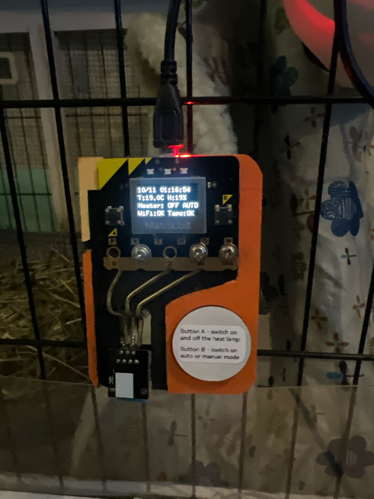
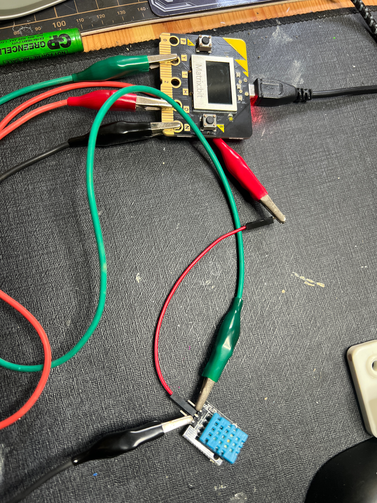

# Matrixbit Thermostat

ESP32 firmware for a matrixbit / mPython-style board. It reads a DHT11/DHT22 temperature sensor and switches a
Tapo smart plug (with your heater plugged into it) over your local Wi-Fi:

- Heater **on** when the temperature is at or below **16.0 °C**.
- Heater **off** again at or above **18.0 °C**. The 2 °C gap stops the plug clicking on and off around 16 °C.
- At least 60 s between automatic switches. If the sensor stops responding for 2 minutes, the heater is turned off as a safety measure.
- **Button A** switches the heater on/off by hand (and puts the thermostat in MANUAL so it doesn't undo it).
- **Button B** switches between AUTO and MANUAL. MANUAL returns to AUTO by itself after 30 minutes (`MANUAL_OVERRIDE_MS`).
- Every 60 s it reads the plug's real state, so changes made in the Tapo app or with the plug's own button are picked up.





## Wiring

| Sensor pin | Board pin |
|------------|-----------|
| VCC / +    | 3V3       |
| GND / -    | GND       |
| DATA / S   | **P1** (GPIO 32) |

Use a 10 kΩ pull-up resistor between DATA and 3V3 if you are using the bare 4-pin sensor rather than a module on a small PCB.

Board labels are **not** GPIO numbers:

| Board pin | GPIO | OK for the sensor? |
|---|---|---|
| P0 (big pad) | 33 | yes |
| P1 (big pad) | 32 | **yes, recommended** |
| P2 (big pad) | 35 | no, input-only |
| P23 (front touch pad "P") | 27 | yes |
| P25 (front touch pad "T") | 12 | no, can stop the board booting |
| P20 / P19 | 23 / 22 | no, used by the on-board screen (I2C) |
| P5 / P11 | 0 / 2 | no, buttons A / B |

By default the firmware scans P1, P23 and P0 at boot and uses whichever pin answers.
Set `SENSOR_GPIO` in `src/main.cpp` to skip the scan.

## Setup

1. `cp src/secrets.example.h src/secrets.h`, then fill in your Wi-Fi details and the Tapo email, password and plug IP.
2. In the **Tapo app**, go to **Me → Third-Party Services** (on some app versions **Me → Tapo Lab**) and turn on
   **Third-Party Compatibility**. Recent plug firmware refuses local control until this is on.
3. Give the plug a fixed IP (a DHCP reservation in your router) so `TAPO_IP` doesn't change.

### PlatformIO (recommended)

```bash
pip install platformio
pio run -t upload
pio device monitor
```

### Arduino IDE

1. **File → Preferences → Additional boards manager URLs:**
   `https://espressif.github.io/arduino-esp32/package_esp32_index.json`
2. **Tools → Board → Boards Manager:** install **esp32 by Espressif Systems** (version 3.x).
3. **Tools → Board → esp32 → ESP32 Dev Module**, then **Tools → Port** → the board's COM port.
   Leave the other Tools settings at their defaults.
4. **Tools → Manage Libraries:** install **DHT sensor library** (Adafruit, accept *Adafruit Unified Sensor*
   when asked), **ArduinoJson** (by Benoit Blanchon, v7) and **U8g2** (by oliver).
5. Create a sketch folder named `matrixbit_thermostat`, copy `src/main.cpp` into it as
   `matrixbit_thermostat.ino`, and copy `tapo_client.h`, `tapo_client.cpp` and `secrets.h` next to it.
6. Upload, then open **Tools → Serial Monitor** at **115200** baud.

## On-board screen

The screen refreshes every second and shows:

```text
03/11 11:26:05
T:15.8C H:45%
Heater: ON  AUTO     (MAN = manual mode, see buttons above)
WiFi:OK Tapo:OK      (Tapo:... = connecting, Tapo:ERR = failed)
```

During boot it shows each step (sensor scan, Wi-Fi, Tapo).

The screen is driven by the U8g2 library (SSD1306 driver, address 0x3C, SDA GPIO 23 / SCL GPIO 22); MPython is
not needed. If you use a different board, upload `screen_test/screen_test.ino`: it cycles through likely
settings and labels the one that works, which you then copy into the screen settings near the top of
`src/main.cpp`.

## Testing

**Plug protocol, without hardware** (Linux/WSL; needs `g++`, `libmbedtls-dev`, `pip install python-kasa`, and one
`pio run` first). This compiles the real `src/tapo_client.cpp` for the PC and runs it against `test/host/mock_plug.py`, a
fake plug built on python-kasa's reference KLAP code:

```bash
test/host/run.sh
```

**Your real plug, without the board**, from any PC on the same Wi-Fi:

```bash
pip install python-kasa
python tools/check_plug.py 192.168.0.106 you@example.com "your password" --toggle
```

If the board gets HTTP 403 but `check_plug.py` works, run `python tools/compare_plug.py <ip> <email> "<password>"`:
it talks to the plug the way python-kasa does and the way the board does, and shows where they differ.

**On the board**, type these into the Serial Monitor (115200 baud, "New Line" line ending):

| Command | What it does |
|---|---|
| `tapo` | Reconnects to the plug and prints `[Test] PASS` or `[Test] FAIL: <reason>` |
| `on` / `off` | Switches the plug (manual mode) and prints PASS/FAIL |
| `auto` | Returns to thermostat control |
| `status` | Prints time, sensor, plug and Wi-Fi status |
| `tapodebug` | Logs in with full `[Dump]` output; paste it into `tools/verify_dump.py` to check every byte against python-kasa |
| `selftest` | Checks the board's KLAP encryption against python-kasa reference values |

## Troubleshooting the Tapo connection

The client tries KLAP first (used by current plug firmware), then the older securePassthrough protocol, and logs
the reason when a step fails:

| Log message | Meaning |
|---|---|
| `handshake1: HTTP 200, 17 bytes ... Body: "{"error_code":-1}"` | The plug refused the local session. Turn on Third-Party Compatibility (setup step 2), then power-cycle the plug. |
| `plug rejected our credentials` | The email or password doesn't match the account that owns the plug. Both are case-sensitive. |
| `HTTP ... connection refused` / `timeout` | Wrong IP, or the plug is on a guest/isolated Wi-Fi network. |
| `invalid Tapo email/password (-1501)` | Legacy firmware rejected the credentials. |
